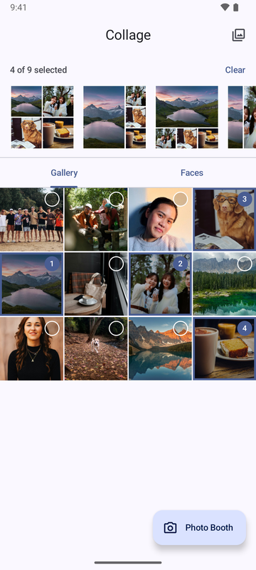
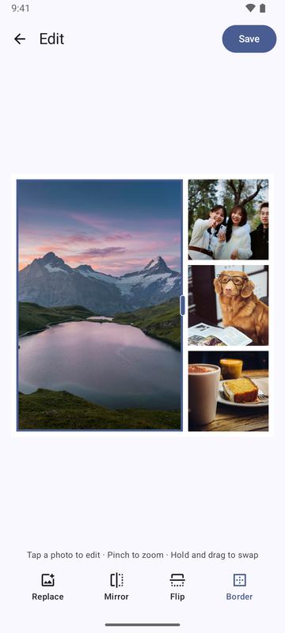
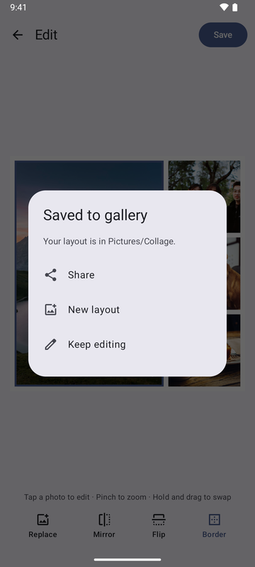

# Collage

A photo collage maker in the spirit of Instagram's discontinued Layout app, written in Kotlin with
Compose Multiplatform for Android and iOS.

## Preview

Android: pick photos and see layout previews, edit the collage, save it. Below: the exported 2048×2048 file (scaled down).

<p>
  
  
  
</p>


Sample photos are from [Unsplash](https://unsplash.com), used under the
[Unsplash License](https://unsplash.com/license), by
[Will Haddock](https://unsplash.com/photos/group-of-friends-posing-on-a-sandy-beach-UnldHt2vxYw),
[sayan Nath](https://unsplash.com/photos/three-friends-laughing-outdoors-under-green-trees-MbOMiTNYejE),
[Tan Duong](https://unsplash.com/photos/a-woman-smiles-in-soft-warm-light-fBRoULRI3Vw),
[Jamie Street](https://unsplash.com/photos/dog-sitting-in-front-of-book-Zqy-x7K5Qcg),
[Ansgar Scheffold](https://unsplash.com/photos/lake-in-the-middle-of-green-mountains-z_f2JrBRbOg),
[Esra Afşar](https://unsplash.com/photos/a-cup-of-coffee-sitting-on-a-table-next-to-a-window-B0yITxid9u8),
[Maccy](https://unsplash.com/photos/three-smiling-friends-posing-outdoors-in-a-park-kVIj63yvRJ0),
[Scott K](https://unsplash.com/photos/pine-forest-reflects-in-a-clear-turquoise-mountain-lake-Sunjg6-30iI),
[Brooke Balentine](https://unsplash.com/photos/a-smiling-woman-poses-for-a-portrait-cdZcNIca4w0),
[Glen Carrie](https://unsplash.com/photos/a-white-dog-running-through-a-forest-filled-with-leaves-0Gu177mbpiA),
[Nick H](https://unsplash.com/photos/moraine-lake-surrounded-by-mountains-T0UJEFWU7EE) and
[Stephen Kidd](https://unsplash.com/photos/YM9GYuBhxoc).

## Status

| Platform | Status |
|---|---|
| Android | Tested manually on an Android emulator and a Google Pixel phone |
| iOS | Verified on a physical iPhone: limited/full Photos access, gallery, Faces, selection, editor gestures/tools, picker, 2048×2048 save/share, iCloud loading, photo booth, rotation and foreground return |

Pinch-to-zoom, iCloud-only loading, physical rotation and unmirrored camera checks were exercised by
the device owner; the remaining checks were driven over iPhone Mirroring. Camera checks included both landscape
directions, front/rear switching, upright mirrored output and rotation during the countdown.

## Features

- Pick up to 9 photos from the gallery, a **Faces** tab (on-device face detection) or the system
  photo picker; works with Android 14+ / iOS limited photo access.
- Share photos to Collage from other apps (Photos, Files, a browser…): they become the selection
  and the layout previews appear. Android registers for `SEND`/`SEND_MULTIPLE` of `image/*`; iOS has
  a share extension (up to 9 photos) that hands the images to the app through an App Group and opens
  it. More than 9 photos on Android keeps the first 9.
- Layout previews for the selected count (1–9 photos, 4–7 layouts each), drawn with your photos.
- Editor: tap to select, drag/pinch to pan and zoom, drag the lines between photos to resize,
  hold and drag to swap; Replace, Mirror, Flip and Border.
  In landscape, tools sit in a right-side rail aligned with Save to give the collage more room;
  portrait keeps the bottom toolbar.
- Saves a 2048×2048 JPEG (Android: `Pictures/Collage`; iOS: the photo library) and opens the share
  sheet. The editor and the export share the same drawing code, so the file matches the screen.
  After saving, Share, New layout and Keep editing are separate full-width actions with icons.
- Photo booth: capture four photos individually, one per shutter tap, then open a 2×2 layout.
  A three-second countdown is on by default for each shot; switch it off for immediate capture.
  Landscape arranges the live preview, a 2×2 shot grid and a vertical capture-control rail
  from left to right. Portrait uses a thumbnail row and bottom controls.
  On iOS, preview and captured photos follow the screen orientation.

## Project layout

| Module | Contents |
|---|---|
| `shared/src/commonMain` | Layout model and maths, view model, all screens, drawing and export, strings and icons |
| `shared/src/androidMain` | MediaStore, `FaceDetector`, photo picker, CameraX |
| `shared/src/iosMain` | Photos, Vision, PHPicker, AVFoundation, share sheet |
| `androidApp` | Activity hosting the shared app; application id `com.jackcheung.collage.android` |
| `iosApp` | Xcode project hosting the shared app; bundle id `com.jackcheung.collage.ios`. `ShareExtension` target: share-sheet entry (`<bundle id>.share`, App Group `group.<bundle id>`) |

## Build

Requirements: JDK 17 or newer. Android needs the Android SDK (platform 37); iOS needs a Mac with
Xcode and Apple Silicon for the simulator.

```shell
./gradlew :androidApp:assembleDebug         # androidApp/build/outputs/apk/debug/androidApp-debug.apk
./gradlew :shared:testAndroidHostTest       # unit tests for the layout model
./gradlew :shared:compileKotlinIosArm64     # type-checks the iOS code (also works on Linux)
```

### iOS

1. Copy the signing template, then set `TEAM_ID` in the ignored local file:

   ```shell
   cp iosApp/Configuration/Signing.xcconfig.example iosApp/Configuration/Signing.xcconfig
   ```

   `Config.xcconfig` contains shared app settings and optionally includes `Signing.xcconfig`.
   Leave signing settings blank for simulator builds; a real device needs your Apple development team.
   Automatic signing registers the share extension's App ID and the App Group for that team.
2. Open `iosApp/iosApp.xcodeproj` and run. Xcode builds the shared framework through Gradle, so
   the JDK must be installed system-wide (or set `JAVA_HOME` in the "Compile Kotlin Framework"
   build phase).
3. The photo booth needs a real device; the simulator has no camera.

Keep signing certificates/private keys in your local Keychain and provisioning profiles managed by
Xcode. Local signing settings, exported signing material and signed app archives are ignored by Git;
do not force-add them. No `skip-worktree` setting is needed.

## License

[MIT](LICENSE)
